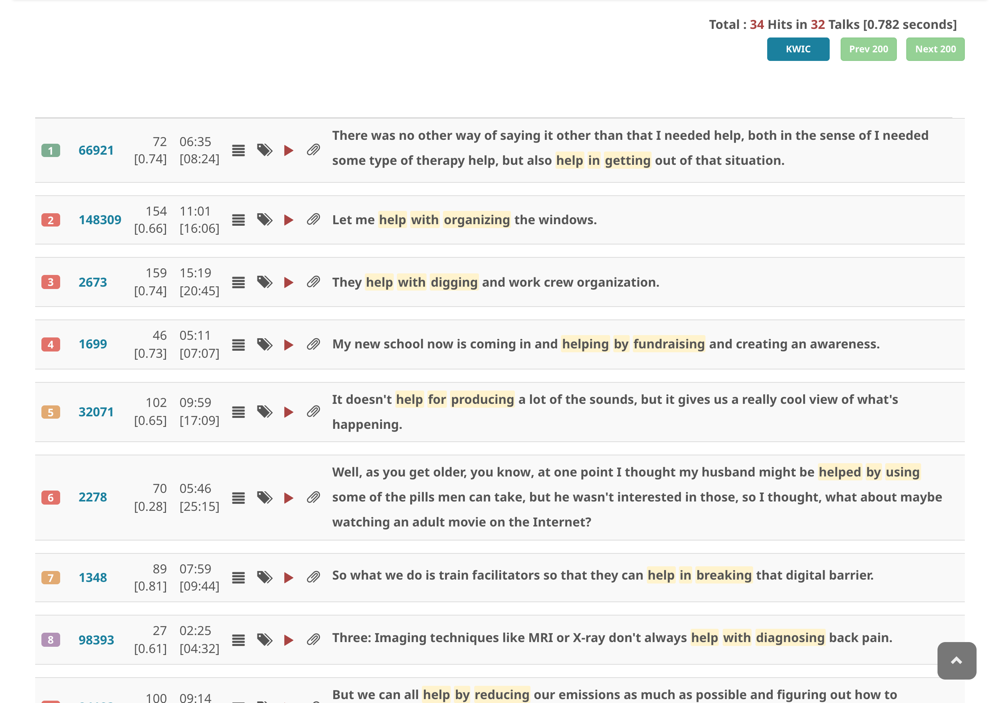

# アドバンスト・サーチで検索する

1. [アドバンスト・サーチのクエリ構文](advanced-search-query-syntax.md)で検索文字列を入力する
2. **Search Target** が **English Transcript** に設定されていることを確認する
3. **Advanced Search** にチェックを入れる
4. **SEARCH** をクリックする

アドバンスト・サーチでは、品詞タグ、レンマ、依存関係、形態素情報、固有表現、ワイルドカードに加え、型付き名詞チャンクスロット（`_{pron}`・`_{%PERSON}`・`_{[life]}`）やスロット間のレンマ照応（`:N` / `=N`）が使用できます。詳しくは[クエリ構文リファレンス](advanced-search-query-syntax.md)を参照してください。

件数は、通常の検索と同じく、行（セグメント、または拡張セグメント）の数です。1つの行に複数回一致したときは1件と数え、その中の一致をすべて強調表示します。KWIC 表示では最初の一致を中央に置きます。v13.8.0 より前は一致の数を数えていたため、件数が表示できる行の数より多くなっていました。
